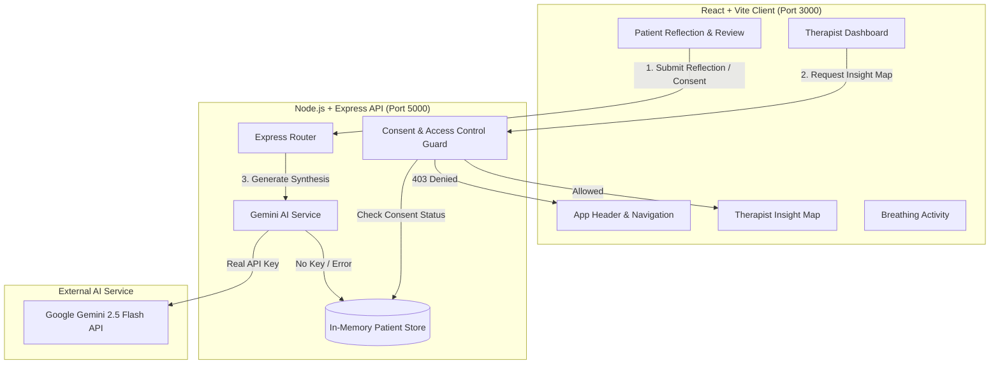

# 🌉 SentiBridge — Beyond Words
### AI-Assisted Patient Insight Platform for Therapists
**Official Hackathon Domain:** Domain 8 — Open Innovation

---

## 📌 Executive Overview

**SentiBridge — Beyond Words** is a therapist-first platform designed to bridge the gap between a patient's internal emotional struggles and what they are able to express verbally during therapy consultations. 

During mental-health consultations, patients often find it difficult to explain feelings, recall complex experiences, discuss sensitive topics, or articulate what is troubling them. Nonverbal cues alone cannot reliably convey internal states. **SentiBridge** collects patient-reported reflections prior to or between sessions through guided tools (Life Map, Topic Preferences, Mind Journal, Situation Stories, and Support Compass) and organizes them into a structured **Therapist Insight Map**.

> ⚠️ **Clinical Safety & Ethical Guardrails**:  
> SentiBridge **does not** claim to read minds, diagnose psychological conditions, measure hidden distress, or replace professional clinical judgment. It organizes patient-provided information to assist therapists in preparing meaningful, nonjudgmental conversations.

---

## ✨ Core Key Features

### 🩺 Screen A — Therapist Dashboard
- **Patient Roster Directory**: Searchable list of fictional patients (`Alex Morgan`, `Jordan Chen`, `Samira Patel`, `Marcus Vance`).
- **Session Schedule**: Live preview of upcoming consultations and session types.
- **Sharing & Consent Status Badges**: Visual distinction between **Sharing Approved** vs **Consent Pending / Unapproved Drafts**.
- **Insight Map Access**: One-click opening of approved patient maps with consent checks.

### 📝 Screen B — Patient Reflection Interface
1. **Life Map**: Self-assessment across academic/work pressure, family expectations, sleep, relationships, and self-confidence.
2. **Topic Preferences**: Label topics as *"I want help with this"*, *"Difficult to discuss"*, *"Not ready to discuss"*, or *"Not relevant"*.
3. **Mind Journal**: Open reflection prompts for thoughts, difficult situations, therapist understanding, and desired support.
4. **Situation Stories**: Everyday scenario choices with voluntary rationale. (Strictly non-diagnostic).
5. **Support Compass**: Session communication preferences (e.g., extra processing time, writing instead of speaking, boundary planning).

### 🤖 Screen C — AI Insight Engine
- Powered by **Google Gemini API** (`gemini-2.5-flash`).
- **Automatic Fallback to DEMO MODE**: If no `GEMINI_API_KEY` is provided or if network calls fail, SentiBridge automatically operates in structured Demo Mode without crashing.
- **Safety Enforcement**: Output is strictly structured JSON. AI content is prevented from diagnosing, scoring severity, or inventing unstated details.

### 🗺️ Screen D — Therapist Insight Map (Primary Feature)
- **Clear Source Differentiation**:
  - 🟢 **Direct Patient Reports**: Quotes and preferences displayed in green/teal verbatim styling.
  - 🟣 **AI Synthesis**: Recurring themes and summary tags.
  - 🔵 **AI Suggested Questions**: Nonjudgmental, trauma-informed conversation starters.
- **Traceability**: Every recurring theme directly cites supporting patient-reported entries.
- **Print & Export**: One-click clinical print view for session documentation.

### 🔒 Screen E — Patient Consent & Access Control
- **Backend Enforcement**: Server blocks clinician requests (`HTTP 403 Forbidden`) if patient has not explicitly authorized sharing.
- **Selective Sharing**: Patients can choose which specific sections (Life Map, Journal, Support Compass) to include or exclude.
- **Revocation**: Consent can be toggled between `APPROVED` and `PENDING_REVIEW` at any time.

### 🫁 Section 7 — Guided Breathing & Grounding
- Interactive 4-4-4-4 box breathing animation with start, pause, and reset controls.
- Voluntary self-reported body tension check-in (1-10 scale).

---

## 🏗️ System Architecture



---

## 🛠️ Technology Stack

- **Frontend**: React 18, Vite, Tailwind CSS, Lucide React Icons
- **Backend**: Node.js, Express.js, CORS, Dotenv
- **AI SDK**: `@google/genai` (Google Gemini 2.5 Flash)
- **Data Persistence**: In-memory state with pre-populated clinical demo data

---

## 🚀 Quick Setup & Local Execution

### 1. Prerequisites
- **Node.js**: v18.0.0 or higher
- **npm**: v9.0.0 or higher

### 2. Clone Repository & Install Dependencies

```bash
# Clone the repository
git clone https://github.com/your-username/sentibridge-beyond-words.git
cd sentibridge-beyond-words

# Install root, server, and client dependencies in one command
npm run install:all
```

### 3. Environment Variable Configuration

Create a `.env` file in the `server/` folder (or copy `.env.example`):

```bash
cp .env.example server/.env
```

Edit `server/.env`:
```env
PORT=5000
GEMINI_API_KEY=your_actual_gemini_api_key_here
```
> *Note: If `GEMINI_API_KEY` is omitted, SentiBridge automatically runs in **DEMO MODE** using structured fallback data.*

### 4. Running the Platform

Run both frontend and backend concurrently:

```bash
npm run dev
```

- **Frontend Application**: `http://localhost:3000`
- **Backend API Server**: `http://localhost:5000`

To run backend or frontend individually:
```bash
# Backend Server only
npm run server

# Frontend Client only
npm run client
```

---

## 🧪 End-to-End Verification Checklist

| Scenario | Steps to Verify | Expected Outcome | Status |
|---|---|---|---|
| **1. Therapist Dashboard View** | Open `http://localhost:3000` in Therapist View | Displays roster of 4 fictional patients, upcoming sessions, and consent badges. | ✅ Verified |
| **2. Patient Consent Restriction** | Click *"Review Consent in Patient View"* on Samira Patel (P-103) | Backend returns `HTTP 403 Forbidden` (`PATIENT_CONSENT_REQUIRED`). Insight map is locked. | ✅ Verified |
| **3. Patient Reflection & Consent** | Switch to **Patient View** for Samira Patel, complete reflection & click *"Approve & Share"* | Status updates to `APPROVED`. Access control opens. | ✅ Verified |
| **4. Therapist Insight Map Display** | Click *"Open Insight Map"* for Alex Morgan | Displays verbatim patient quotes (teal), AI summary (purple), and suggested questions (indigo). | ✅ Verified |
| **5. AI Generation Fallback** | Run server without `GEMINI_API_KEY` | Server health returns `DEMO_MODE`. App operates seamlessly without crashing. | ✅ Verified |
| **6. Breathing Activity** | Switch to **Breathing Activity** | Interactive expanding circle operates with 4-4-4-4 timer and voluntary check-in. | ✅ Verified |

---

## 📄 License & Hackathon Disclaimer

This repository is built for hackathon demonstration purposes (**Domain 8 — Open Innovation**). All patient names, profiles, and journal entries are strictly fictional. SentiBridge is an administrative and reflective communication aid and does not constitute a diagnostic or clinical medical device.
